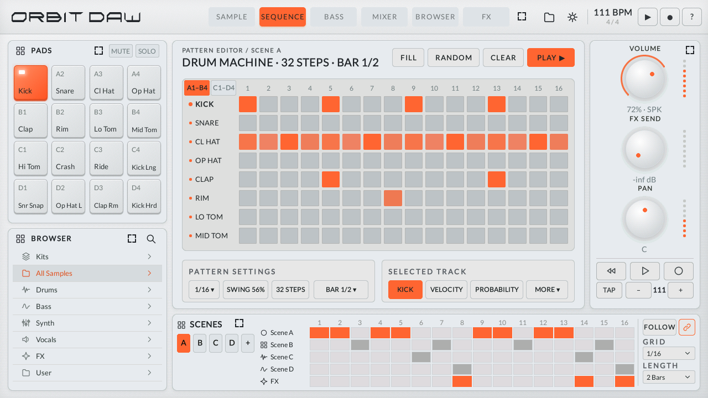
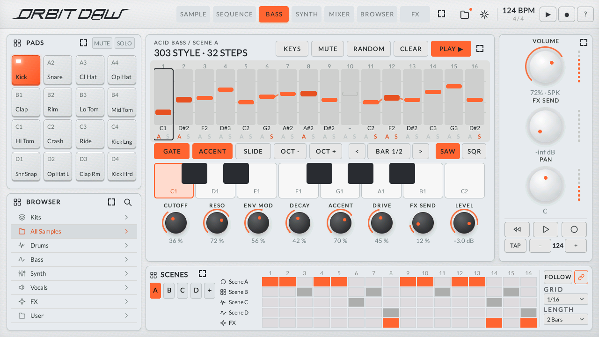
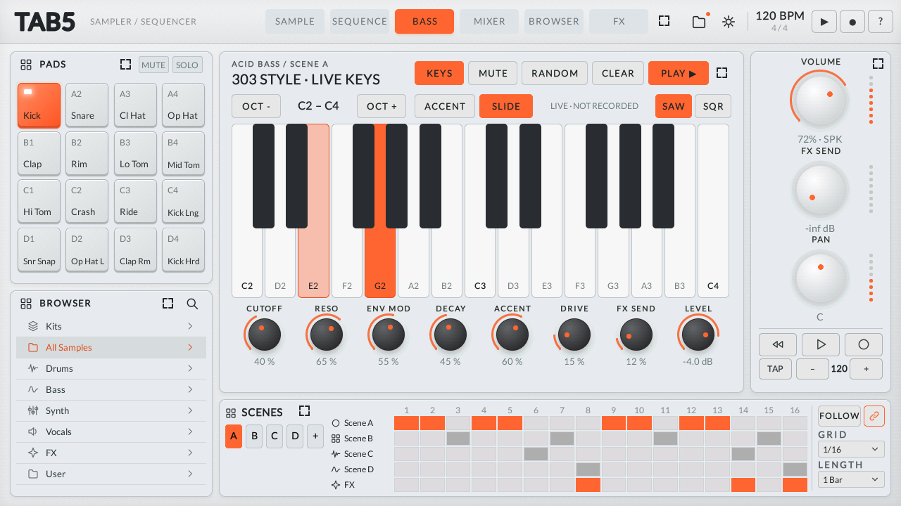
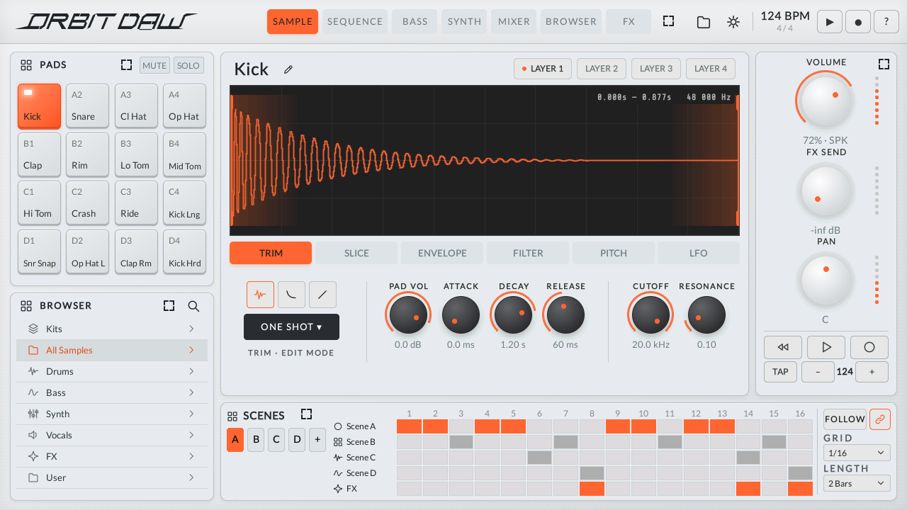
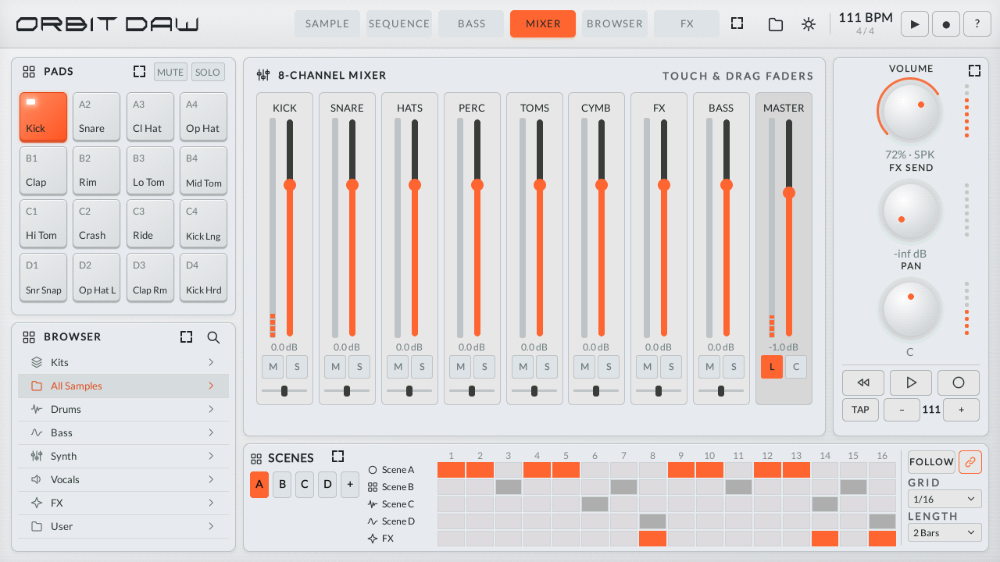
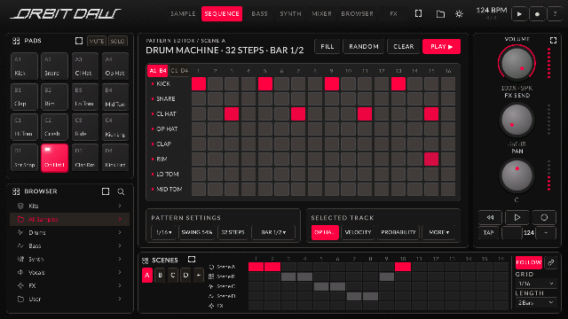
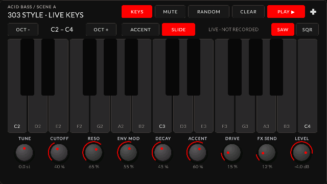

# ORBIT DRUM

**A drum machine, sampler and 303-style bass synth for the M5Stack Tab5 (ESP32-P4).**



ORBIT DRUM is firmware written from scratch in C++17 on ESP-IDF 5.5.2 and LVGL 9.3 for the 5" 1280×720
touch screen of the M5Stack Tab5. It has 16 multi-touch pads, a step sequencer, a sample editor, a mixer with
effects, scenes and a song arrangement, and an acid bass line with a live keyboard. The engine renders at 48 kHz
with about 7 ms of output latency.

Current version: **0.4.9**. Polish manual and version history: [docs/INSTRUKCJA_PL.md](docs/INSTRUKCJA_PL.md).

## Features

- **Pads**: 16 pads; the sound starts on finger-down, several fingers at once (up to 5). MUTE / SOLO pad modes.
- **Sample editor**: the real waveform with START / END handles (double tap snaps to a zero crossing); TRIM, SLICE
  (auto or grid, slices to pads), ENVELOPE, FILTER, PITCH and LFO pages; 4 layers per pad. Destructive tools
  (normalize, reverse, trim, fade, mono, crush) with UNDO, and WAV export.
- **Sequencer**: 8 tracks × 16 steps per bar, up to 64 steps. Velocity, probability, ratchet, nudge, pitch and
  conditions per step. Swing, division, FILL, RANDOM / CLEAR with UNDO, live recording from the pads.
- **Mixer**: 8 buses + master with faders, meters, mute / solo, a limiter and a metronome.
- **FX**: reverb, tempo-synced delay, LO-FI / WIDE / PUMP / SPACE macros, master limiter.
- **ACID BASS**: a 303-style monophonic voice (24 dB resonant ladder filter, accent, slide, saw / square) with one
  line per scene, from C0 to C5. Edit it on a step keyboard or by drawing notes on the line.
  **KEYS** mode: a two-octave live keyboard played with several fingers (OCT ± from C0 up to C7). The newest key
  sounds, and lifting it returns to the key still held; with SLIDE the notes glide like a 303. Nothing is recorded.
- **SYNTH** (0.4.9, its editing view comes next): a 4-voice virtual-analog synth in the manner of a SYSTEM-1 (two
  oscillators with COLOR, sync, ring and cross-mod, sub and noise, -24 / -12 dB filters, two envelopes, LFO, POLY /
  MONO / UNISON, 8 factory patches). Every scene has a synth note line (chords of up to 4 notes, each with its own
  length) that plays with the drums and the bass on mixer channel 7.
- **Performance** (0.4.9, the sound bit-identical to before): the SYNTH renders on the second CPU core while the
  drums render; the reverb's delay lines live in internal RAM and the display's draw buffers in PSRAM (the reverb
  costs half, the UI draws faster); the pads redraw only what changes. The dense demo scene D takes ~48 % of the audio
  core (72 % before). Big memory work while the audio plays (loading or editing big samples, unpacking a kit) yields
  to the audio, so it causes no dropouts.
- **Scenes and song**: scenes A–D switch on the bar. A 16-slot song arrangement has an FX-throw row and FOLLOW
  playback.
- **Browser**: samples and kits on the microSD card, a category list next to the search, search with an
  on-screen keyboard, waveform preview, LOAD TO pad, LOAD KIT.
- **Built-in kits**: 808-STYLE and 909-STYLE, synthesized from circuit descriptions (no Roland samples). They work
  without a card.
- **Demo**: every start opens one demo track in the manner of the 303 + 909 sound of Daft Punk's "Da Funk"
  (111 BPM, G minor, a distorted acid line over a plain 909 groove; our own notes). Scenes A–D are its intro,
  groove, break and full part; turn on FOLLOW to play them as a song. NEW PROJECT starts empty.
- **Projects** on microSD (FAT32 or exFAT) with autosave and JSON export.
- **USB-MIDI host** (USB-A): notes to pads, transport, clock in / out, MIDI learn for 32 controls.
- **Bluetooth A2DP** headphones and speakers through an M5Stamp Pico bridge (see below).
- **Sharp maximize**: any panel can be enlarged. It is rebuilt natively larger, with bigger fonts and icons, not
  scaled up as a bitmap. The BASS view can take the whole screen. A category of the enlarged BROWSER panel opens
  its files in the large view at once.
- **Tab5 Keyboard** (the M5Stack keyboard for the Tab5): shortcuts like Ableton Live and a computer MIDI keyboard
  (see [Tab5 Keyboard](#tab5-keyboard)). It can be plugged in and out while ORBIT runs.
- **Interface size**: Standard, Large or Extra large (Settings → Display) for larger dialogs, lists and touch
  areas. The settings window itself is drawn larger than the other dialogs.
- **Colors**: 6 base palettes (LIGHT, WARM, SILVER, SLATE, DARK, BLACK), 8 accent colors and a custom accent
  (hue / saturation).
- **Outputs**: wired headphone detection, and a separate volume for speaker, headphones and Bluetooth.

## Screenshots

| | |
|---|---|
|  |  |
| BASS: the 303 line, step row and step keyboard | BASS KEYS: two keys held, the newest one sounds |
|  |  |
| SAMPLE editor | MIXER |
|  |  |
| On a Tab5 (DARK base, custom red accent) | BASS KEYS on the whole screen (on a Tab5) |

The first rows are rendered on a PC by the test harness; the last row is read back from a Tab5's screen.

## Hardware

- **M5Stack Tab5**: ESP32-P4 v1.x, 16 MB flash, 32 MB PSRAM. Tested on a v1.3 board with the ST7121 panel.
- microSD card (optional).
- Optional: a USB-MIDI controller (USB-A port).
- Optional, for Bluetooth: an **M5Stamp Pico** running the
  [Aurora Player](https://github.com/UNIZERSION/aurora-player) "Pico Bluetooth bridge" firmware 0.9.x, wired to the
  Tab5:

  | Tab5 | Pico | Signal |
  |---|---|---|
  | G5 / G18 / G19 | G26 / G25 / G22 | I2S BCK / WS / DATA (the Tab5 drives the clock) |
  | G6 | G32 | UART to the Pico; a 120 ms low pulse wakes it |
  | G46 | G33 | UART from the Pico |
  | 5V / GND | 5V / GND | power |

## Installing

Download the files from the [Releases](../../releases) page:

- `ORBIT_DRUM_SD_<version>.zip`: unpack it to the root of a microSD card (it creates the `ORBIT` folder: the app
  image, a hardware self-test image and the kits).
- `ORBIT_DRUM_<version>.bin`: the app image alone.

**With a launcher on the Tab5** (an app launcher that installs images from the SD card into its app slot, such as
the UiFlow2 partition scheme with a 7552 KB `app0` slot): insert the card, choose `ORBIT/ORBIT_DRUM_<version>.bin`
in the launcher, install it and start it.

**Standalone** (no launcher): build and flash from source with `idf.py -C firmware -p <port> flash`. This writes
the bootloader, the partition table in `firmware/partitions.csv` (a 7 MB factory app) and the app, so it replaces
whatever was on the Tab5, including a launcher.

`ORBIT/TEST/ORBIT_SELFTEST_<version>.bin` is a hardware self-test: color bars, touch points, a 440 Hz tone, a
metronome with latency and dropout statistics, headphone detection, the SD card, the battery and FPS.

## Using it

| Part | What it does |
|---|---|
| **PADS** | Tap to play (several fingers at once). MUTE / SOLO switch the pad mode. |
| **SAMPLE** | Drag the START / END handles. The tabs change the knob page. LAYER 1–4: hold for layer mode and clear. The pencil opens SAMPLE DETAILS (destructive edits, WAV export, choke, output bus, polyphony). |
| **SEQUENCE** | Tap or drag to paint steps. VELOCITY, PROBABILITY and MORE (RATCHET, NUDGE, PITCH, COND) edit the step values. |
| **MIXER** | Faders (double tap = 0 dB), meters, M / S, L = limiter, C = metronome. |
| **BROWSER** | Samples and kits from the card, the category list next to the search, ▶ PREVIEW, LOAD TO pad, LOAD KIT (with confirmation and UNDO). |
| **FX** | Reverb, delay, macros, limiter, master. |
| **BASS** | Tap a step, then a key (the note, then the next step), or draw notes on the line. GATE / ACCENT / SLIDE / OCT ± for the selected step, SAW / SQR, MUTE, RANDOM, CLEAR with UNDO. **KEYS**: the live two-octave keyboard (OCT ± range, ACCENT, SLIDE). The line spans C0–C5. Knobs: CUTOFF, RESO, ENV MOD, DECAY, ACCENT, DRIVE, FX SEND, LEVEL. |
| **Right panel** | VOLUME of the output that plays now (speaker, headphones or Bluetooth), FX SEND and PAN of the selected pad, transport, TAP tempo, BPM ± (hold to type it). |
| **Maximize** | The corner-marks button of a panel enlarges it; the same button restores it. BASS has its own button next to PLAY for the whole screen. In the enlarged BROWSER panel a category (or the search) opens the large BROWSER view. |
| **SCENES** | Scenes A–D, "+" for copy / clear / undo, the song slots and the FX row, GRID and LENGTH. |
| **Top bar** | Folder = projects (save, open, new, delete, export JSON). Gear = settings (General, Audio, MIDI, Bluetooth, Display, Touch, Storage, About). ? = the guide. |

Knobs: drag vertically; a double tap restores the default value. Settings → Display → Animations turns the
animations off. Settings → Display → Interface size makes the dialogs, lists and touch areas larger (the touch
areas of every screen after a quick restart).

## Tab5 Keyboard

The M5Stack Tab5 Keyboard works like a computer keyboard in Ableton Live:

| Key | Action |
|---|---|
| Space | Play from the start / stop |
| Shift+Space | Continue from where it stopped |
| Enter | Play (when stopped) |
| F9 | Record (REC) |
| Tab / Shift+Tab | Next / previous view (SAMPLE, SEQUENCE, BASS, MIXER, BROWSER, FX) |
| A W S E D F T G Y H U J K O L P ; ' | Notes (computer MIDI keyboard): in BASS the 303, elsewhere the pads A1–D4 |
| Z / X | Octave down / up |
| C / V | Velocity down / up |
| M | Computer MIDI keyboard on / off |
| Up / Down | Scene |
| Left / Right | Pad |
| 0 | Mute the selected pad |
| F1–F8 | Mute the pads of the shown bank |
| F11 | Enlarge the work area (BASS: the whole screen) |
| Esc | Close a dialog or menu, restore an enlarged panel |
| Ctrl+Z | Undo |
| Ctrl+S | Save the project |
| Ctrl+O, Ctrl+N, Ctrl+Shift+S | Project manager |
| Ctrl+, | Settings |
| Ctrl+Alt+B / Ctrl+Alt+M | BROWSER / MIXER |
| Shift+F1 | UI guide |

While the on-screen keyboard is open (project name, search, tempo), the keys type into it: Enter = OK,
Esc = cancel.

## SD card layout

```
/ORBIT/KITS/<kit name>/                      up to 16 WAV files -> pads A1..D4 (name order or kit.txt: "01=file.wav")
/ORBIT/SAMPLES/Drums|Bass|Synth|Vocals|FX/   browser categories
/ORBIT/USER/                                 your own and edited samples (SAVE WAV)
/ORBIT/PROJECTS/                             projects (.orb, JSON)
```

WAV 8/16/24/32-bit integer or 32/64-bit float, mono or stereo, any sample rate (44.1 / 48 kHz play without
resampling).

## MIDI

A USB-MIDI controller on the USB-A port plays the pads on channel 10 (configurable), using the GM / 909 map (36 kick,
38 snare, 42 closed hat, 46 open hat, 39 clap, 37 rim, 41 / 45 / 48 toms, 49 crash, 51 ride). Start / Stop /
Continue drive the transport. The input clock can set the tempo, and clock output is optional. MIDI learn:
Settings → MIDI → Learn, move a knob, then the controller.

## Bluetooth audio

The Tab5 has no classic Bluetooth (its ESP32-C6 is BLE only), so A2DP audio goes through an M5Stamp Pico running
the Aurora Player bridge (wiring above). In **Settings → Bluetooth**:

- the switch wakes the module;
- SCAN finds devices in pairing mode; tap one to connect (the Pico remembers 8);
- TEST plays a left / right tone;
- **Also speaker / jack** plays locally too;
- the headphone buttons control the transport.

While Bluetooth is on, the engine runs at 44.1 kHz.

Bluetooth adds latency: SBC through the Pico and the headphones' own buffer usually add 150–300 ms. Play live on
the speaker or wired headphones. Since 0.4.4 the Tab5 reads how much audio waits in the Pico's buffer every 2 s
(Settings → Bluetooth shows "bufor Pico ok. X ms"). When that buffer has grown, it empties it in a silent moment.

## Building from source

Requirements:

- [ESP-IDF 5.5.2](https://docs.espressif.com/projects/esp-idf/en/v5.5.2/esp32p4/get-started/), found through
  `IDF_PATH` or in `~/esp/v5.5.2/esp-idf`;
- Python 3;
- [zig 0.17](https://ziglang.org/) for the PC tests;
- on Windows, Git Bash for the shell scripts.

```bash
idf.py -C firmware reconfigure    # first time only: downloads the components (the PC tests use its LVGL too)
idf.py -C firmware build          # or, on Windows: powershell -File tools/idf_build.ps1 -Project firmware
```

The first configure downloads the components pinned in `firmware/dependencies.lock` into
`firmware/managed_components` (network needed). After that, builds work offline. `firmware_selftest` builds the
same way.

```bash
bash tools/run_host_tests.sh      # 16 test suites on the PC (after the first configure above)
python tools/make_release.py      # checks the images and assembles release/KARTA_SD (+ manifest.json)
```

The PC tests cover the engine, sequencer, bass voice, WAV I/O and sample tools (with fuzzing), kits, the app
controller, the widgets (text contrast in every palette), the Bluetooth bridge protocol and the Tab5 HAL logic. They
also render screenshots of the whole UI to `host/shots/`.

**Device tests** (0.4.4+): the firmware has a test console on its USB port. `tools/device_test.py` uses it to tap,
drag and hold fingers on the real touch path, read the app state and audio telemetry, and take screenshots of the
screen. It needs the pyserial package, which comes with the ESP-IDF Python environment.

```bash
python tools/device_test.py COM3 --soak 60
```

`tools/fontgen` and `tools/kitgen` rebuild the fonts and the built-in kits.

## Project layout

| Folder | Contents |
|---|---|
| `firmware/main/core` | audio engine (32 voices, SVF filters, envelopes, LFOs, layers, choke, FX, limiter), sample-accurate sequencer, 303-style bass voice, WAV, sample tools, slicing, library, projects, kits |
| `firmware/main/hal` | Tab5 hardware: tear-free display (PPA rotation, 3 frame buffers), 5-point touch, I2S / ES8388 audio, SD with exFAT, settings, USB-MIDI, Bluetooth bridge (UART + I2S) |
| `firmware/main/ui` | the app controller, the screens, widgets, fonts, icons, the test console |
| `firmware_selftest` | the hardware self-test app |
| `host/` | the PC harness (headless LVGL, fake HAL) and the tests |
| `tools/` | build, test, release, font and kit tools |
| `docs/` | specification, hardware notes, kit design, Polish manual (the docs are in Polish) |

## Status

Tested on one Tab5 (v1.3, ST7121 panel):

- **PC**: all 16 test suites pass.
- **Automated device test**: 33 of 33 checks pass. It covers every view, the pads (two at once), the
  transport, the scenes, BASS KEYS with two fingers, a knob turned while a key is held, full screen, maximize,
  every settings page, and 60 s of playback without audio dropouts.
- **Not yet checked on hardware**: USB-MIDI with a real controller, and the Bluetooth buffer re-sync with real
  headphones.

## License

MIT, see [LICENSE](LICENSE). Third-party components and fonts: [THIRD_PARTY_NOTICES.md](THIRD_PARTY_NOTICES.md).

"TR-808", "TR-909" and "TB-303" are trademarks of Roland Corporation. They are used here only to describe the
style of sound. This project is not affiliated with Roland, and it contains no Roland samples or code.
